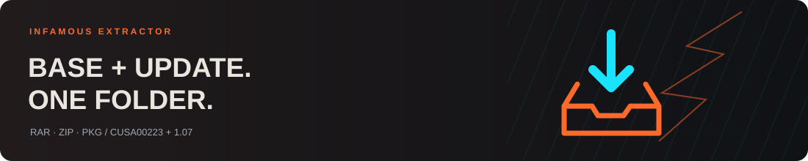
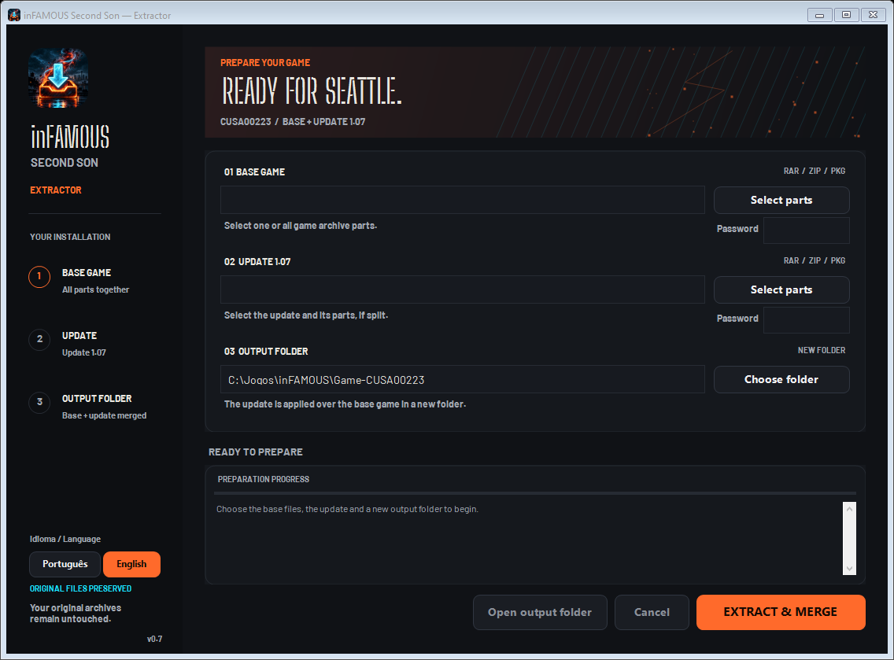

<p align="center"><a href="README.md">Português (Brasil)</a> | <strong>English</strong></p>

<p align="center"></p>
<h1 align="center">inFAMOUS Extractor</h1>
<p align="center"><strong>Your parts. Your update. One ready folder.</strong></p>
<p align="center">
  <a href="https://github.com/sponsors/Fe-Aoki"></a>
</p>
<p align="center"><sub>Voluntary support for development. The application remains free and open source.</sub></p>
<p align="center"><a href="https://github.com/Fe-Aoki/infamous-extractor/releases/latest"><strong>⬇ Download for Windows</strong></a> · <a href="https://github.com/Fe-Aoki/infamous-extractor/issues">Report an issue</a></p>
<p align="center">
  
  
  
  
</p>



A desktop preparation tool for **inFAMOUS Second Son CUSA00223 + update 1.07**. Select your own files, enter archive passwords when required, and create the output folder for [iss_pc](https://github.com/HayatoG/iss_pc).

**Independent, early-stage project.** Includes no game files and does not download games. The game and the official launcher are separate projects. This tool is not affiliated with Sony, Sucker Punch or the dependency authors.



## Features

| Input | Behavior |
| --- | --- |
| `.part1.rar`, `.part2.rar`, `.part3.rar` | Select one or all parts; the tool starts with the first part and reads the set once. |
| `.zip.001`, `.zip.002`, `.zip.003` | Recognizes split ZIP volumes. |
| Multiple independent ZIPs | Extracts them sequentially into the same temporary area. |
| Compatible `.pkg` | Extracts PFS using the corrected full-sector reader. |
| Base + update | Checks PKG title, type and update version, then applies update files over the base game. |

- Portuguese (Brazil) and English, switchable without restarting.
- Dark theme, orange accents and a custom extraction icon.
- Separate passwords for base and update archives.
- Cancellation, progress log and disk-space checks at each stage.
- Direct PKG reading from compatible stored RAR5 archives, avoiding an intermediate copy.
- Original input files preserved; an existing output installation cannot be overwritten.
- The final output folder is published only after preparation and structural checks succeed.

## How to use

1. Download the **complete compiled package** from the latest release: `Preparador-inFAMOUS-v0.7.zip`. GitHub's automatic source-code ZIP does not contain the compiled app.
2. Extract the entire package and open `Preparador-inFAMOUS.exe`.
3. In the sidebar under **Idioma / Language**, select **English**.
4. Under **Base game**, click **Select parts**. Use **Ctrl** or **Shift** to select multiple volumes.
5. Select **update 1.07** in the separate update field.
6. Enter passwords if needed, then choose a **new output folder**.
7. Click **Extract & merge**. When finished, select the generated folder in the iss_pc game launcher.

Keep all complete volumes together in the same folder with their original names. The tool does not download missing parts. Additional DLC packages are skipped and reported in the log.

### Language

The first launch uses Portuguese on a Portuguese-language Windows installation, and English otherwise. Your selection is saved to `%LOCALAPPDATA%\Preparador-inFAMOUS\language.txt` and restored next time. Paths, passwords and file selections are retained when switching languages. The selector is disabled during preparation. Existing log entries keep their original language; new application messages use the current choice. Windows file-picker buttons and messages from Windows or third-party libraries may follow their own language settings.

### What if my download uses another format or is already a folder?

Compatibility depends on the files and their contents. This tool targets **inFAMOUS Second Son CUSA00223 with update 1.07**. The full test used one particular package set; compatibility with other packages is not guaranteed.

| What you have | What to do |
| --- | --- |
| A folder containing RARs, ZIPs or a PKG | Select the **files inside that folder** in the base and update fields. All volumes must be complete. |
| A single RAR or ZIP | Select that file. Three parts are not required. Its contents must still be compatible. |
| An already-extracted game, with `eboot.bin` and game folders | This version **does not accept an extracted folder as input**. If it is complete and already has the required update, select the folder directly in the iss_pc launcher. |
| Extracted base game with a separate update | This version does not apply an update to an existing folder. Use supported base/update input files and a new destination. |
| A different region, game or update version | Not guaranteed to work. Renaming files or folders does not make them compatible. |

Having `eboot.bin` alone does not prove that a game installation is complete. The launcher also needs the other expected files and the correct game version. This tool does not convert regions or repair every package.

### Requirements and disk space

- Windows x64 and **.NET Framework 4.8**.
- PowerShell is **not required to run** the compiled application.
- A local drive with space for the extracted game and temporary files.
- Preparation from compressed archives may require approximately **50–60 GB free**, depending on the contents. Peak extraction usage exceeds final installation size.

Temporary files are stored beside the destination in `.iss-preparador-<identifier>`. The tool attempts cleanup after success, cancellation or failure, and logs the path if cleanup fails.

## Verification

Version **0.7 passed 18 functional checks**, including language preference persistence, switching both ways without changing paths/passwords, translated errors and logs, and an English extraction/merge with generated examples. Both interfaces were rendered for visual inspection.

Version **0.6** also completed a full real-game extraction through the automation entry point, which uses the same engine as the interface: **1,827 base files**, **458 update files**, and **1,847 merged files**, all identical by SHA-256 to a previously working local installation. That reference is local, not an official hash manifest. The game subsequently started and reached the scene. This large extraction was not repeated for the language-only revision.

Other checks cover synthetic PKGs, three stored RAR5 volumes, multiple independent ZIPs, split password-protected ZIPs, incorrect passwords, unsafe paths, links, cancellation and output protection. [Validation output](docs/VALIDACAO.txt) and [test details](docs/TESTES.md) are available in Portuguese.

## Build from source

Use Windows x64 and **PowerShell 7.6**, the version used for validation. Its bundled Roslyn compiler is used; this build procedure does not require a separate .NET SDK.

```powershell
pwsh -NoProfile -File .\scripts\build.ps1
```

Output: `dist/Preparador-inFAMOUS/Preparador-inFAMOUS.exe`.

Run small generated tests without game files:

```powershell
pwsh -NoProfile -File .\scripts\test.ps1
```

Examples and reports are written to `artifacts/tests`. Two optional public RAR fixtures must be supplied separately; without them, those two cases are skipped. The remaining examples are generated locally. Language tests use an isolated preference file and do not change your personal language setting.

To build the distribution package:

```powershell
pwsh -NoProfile -File .\scripts\package.ps1
```

## Limitations

- Targets **CUSA00223 / update 1.07**.
- The library must be able to recover the PKG's PFS key. This is not a universal PS4 package extractor.
- Does not install extra DLCs or modify the official launcher.
- Final checks verify structure, essential files and extracted sizes; the application does not compare the full game against reference hashes.
- Prepares files; does not optimize FPS.
- If your system restricts long paths, use a short destination such as `C:\Games\Game-CUSA00223`.

An optional XML automation entry point is documented in [docs/AUTOMACAO.md](docs/AUTOMACAO.md) (Portuguese). Automation markers remain unchanged by language selection.

## Contributing

Contributions and issue reports in **Portuguese or English** are welcome. See [CONTRIBUTING.md](CONTRIBUTING.md). Include app version, archive format and the error message. Remove personal paths and never upload game files, passwords or commercial packages.

## Credits and licenses

| Component | Origin / license |
| --- | --- |
| Interface and integration | GPL-3.0-or-later; see [LICENSE](LICENSE). |
| LibOrbisPkg / PkgTool | [Maxton and contributors](https://github.com/maxton/LibOrbisPkg), LGPL-3.0. Complete sources in `vendor/LibOrbisPkg`. |
| PFSC fix | `PFSCReader.ReadSector` repeats `DeflateStream.Read` until the sector is full or EOF is reached; [patch](licencas/Correcao-extrator.patch). |
| 7-Zip 26.04 | [Igor Pavlov](https://www.7-zip.org/); license and unRAR restrictions included. Corresponding official source in `vendor/7z2604-src.tar.xz`. |
| Barlow / Big Shoulders Stencil Display | SIL Open Font License; notices in `licencas/`. |
| Visual identity | Inspired by [HayatoG's iss_pc launcher](https://github.com/HayatoG/iss_pc). Launcher code is not included as part of this application. |
| Icon | AI-generated variant based on the visual reference supplied for this project; prompt in `assets/ICON-PROMPT.txt`. |

Dependencies and fonts retain their original licenses. See [THIRD_PARTY_NOTICES.md](THIRD_PARTY_NOTICES.md) for details. inFAMOUS is used to identify the supported game; this independent project is not endorsed by its trademark owners.
