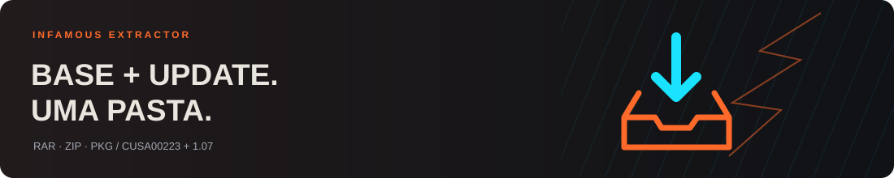
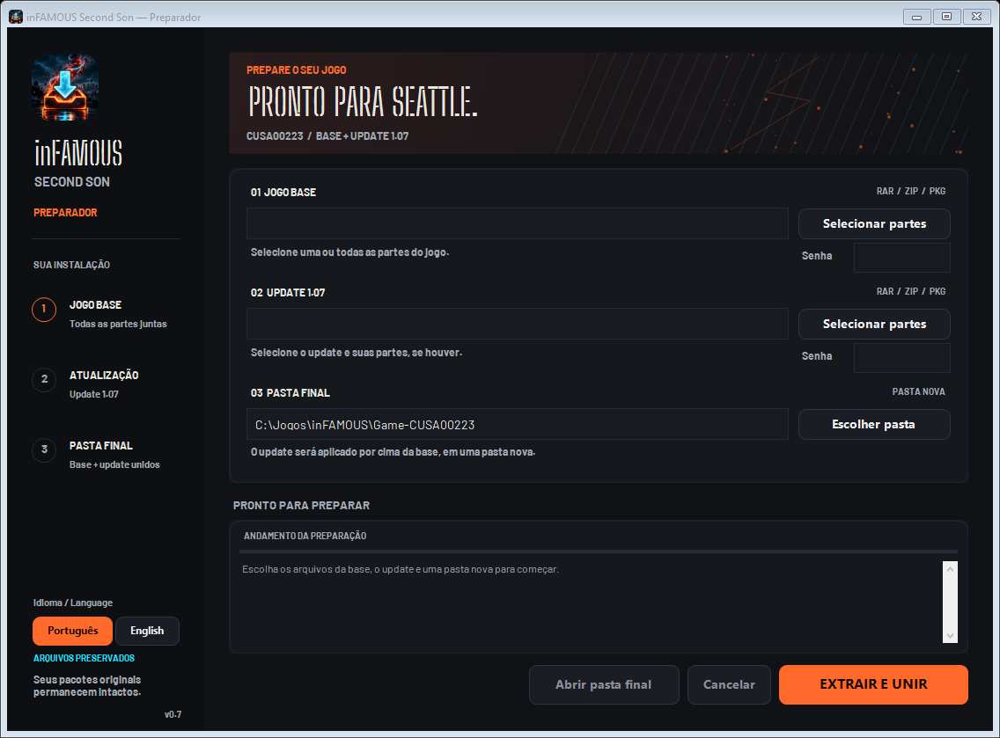

<p align="center"><strong>Português (Brasil)</strong> | <a href="README.en.md">English</a></p>

<p align="center">
  
</p>

<h1 align="center">inFAMOUS Extractor</h1>

<p align="center"><strong>Suas partes. Seu update. Uma pasta pronta.</strong></p>

<p align="center">
  <a href="https://github.com/sponsors/Fe-Aoki"></a>
</p>
<p align="center"><sub>Apoio voluntário ao desenvolvimento. O programa continua gratuito e open source.</sub></p>

<p align="center">
  <a href="https://github.com/Fe-Aoki/infamous-extractor/releases/latest"><strong>⬇ Baixar para Windows</strong></a> ·
  <a href="https://github.com/Fe-Aoki/infamous-extractor/issues">Relatar problema</a>
</p>

<p align="center">
  
  
  
  
</p>

<p align="center">
  <a href="#como-usar">Como usar</a> ·
  <a href="#o-que-ele-faz">Recursos</a> ·
  <a href="#compilar">Compilar</a> ·
  <a href="#verificação">Verificação</a> ·
  <a href="#créditos-e-licenças">Créditos</a>
</p>



Preparador com interface para **inFAMOUS Second Son CUSA00223 + update 1.07**. Selecione seus arquivos, informe as senhas quando necessário e monte a pasta final para usar no [iss_pc](https://github.com/HayatoG/iss_pc).

**Projeto independente e em fase inicial.** Não inclui nem baixa arquivos de jogos. O jogo e o launcher oficial são projetos separados. Não há vínculo com Sony, Sucker Punch ou os autores das dependências.



## O que ele faz

| Entrada | Comportamento |
| --- | --- |
| `.part1.rar`, `.part2.rar`, `.part3.rar` | Aceita selecionar uma ou todas as partes; começa pela primeira e lê o conjunto uma vez. |
| `.zip.001`, `.zip.002`, `.zip.003` | Reconhece volumes ZIP divididos. |
| Vários ZIPs independentes | Extrai em sequência para a mesma área temporária. |
| `.pkg` compatível | Extrai o PFS com a correção de leitura integral de setores. |
| Base + update | Confere título/tipo/versão dos PKGs e aplica os arquivos do update por cima da base. |

- Português (Brasil) e English, com troca sem reiniciar e preferência salva.
- Tema escuro, destaque laranja e ícone de extração próprio.
- Senhas separadas para base e update.
- Cancelamento, registro do andamento e verificação de espaço por etapa.
- Leitura direta de PKG em RAR5 armazenado compatível, evitando uma cópia intermediária.
- Arquivos originais preservados.
- Instalações existentes protegidas: o destino precisa ser uma pasta nova.
- Pasta final publicada somente depois da preparação e da verificação estrutural.

## Como usar

1. Obtenha o **pacote compilado completo** fornecido na release. O ZIP de código-fonte do GitHub não contém o aplicativo compilado.
2. Extraia todo o pacote e abra `Preparador-inFAMOUS.exe`. Em **Idioma / Language**, escolha **Português** ou **English**.
3. Em **Jogo base**, clique em **Selecionar partes**. Use **Ctrl** ou **Shift** para escolher os volumes juntos.
4. Selecione o **update 1.07** no campo separado.
5. Informe as senhas, se houver, e escolha uma **pasta final nova**.
6. Clique em **Extrair e unir**. Ao concluir, selecione a pasta criada no launcher do iss_pc.

Mantenha todos os volumes completos na mesma pasta e com os nomes originais. O programa não baixa partes ausentes. DLCs extras são ignorados e informados no log.

### E se o jogo veio de outro pacote ou já está em uma pasta?

O formato e o conteúdo dos arquivos determinam a compatibilidade. O preparador é direcionado a **inFAMOUS Second Son, região/título CUSA00223, com update 1.07**. O teste integral foi feito com um conjunto específico; outros pacotes não têm compatibilidade garantida.

| O que você tem | Como proceder |
| --- | --- |
| Uma pasta contendo RARs, ZIPs ou um PKG | Selecione os **arquivos dentro da pasta** nos campos de base e update. Os volumes precisam estar completos. |
| Um único RAR ou ZIP | Selecione o arquivo. Não é obrigatório o jogo vir em três partes. O conteúdo ainda precisa ser compatível. |
| Jogo já extraído, com `eboot.bin` e as pastas do jogo | A versão atual **não aceita uma pasta extraída como entrada**. Se a instalação já estiver completa e com o update exigido, selecione essa pasta diretamente no launcher iss_pc. |
| Base já extraída e update ainda separado | A versão atual não aplica um update sobre uma pasta existente. Para preparar pelo aplicativo, use os arquivos de base e update aceitos e escolha um destino novo. |
| Outra região, outro jogo ou outra versão de update | Não há suporte garantido. Não renomeie pastas ou arquivos para tentar torná-los compatíveis. |

Ter apenas `eboot.bin` não comprova que a instalação esteja completa. O launcher também depende dos demais arquivos esperados e da versão correta do jogo. O preparador não converte regiões, não corrige qualquer pacote e não transforma um jogo diferente em uma instalação compatível.

### Requisitos e espaço

- Windows x64 com **.NET Framework 4.8**.
- Não exige PowerShell para **usar** o executável.
- Unidade local com espaço para o jogo extraído e para os temporários.
- Uma preparação completa a partir de arquivos comprimidos pode exigir aproximadamente **50–60 GB livres**, conforme o conteúdo. A instalação final ocupa menos que o pico da extração.

Os temporários ficam ao lado do destino em `.iss-preparador-<identificador>`. O programa tenta limpá-los ao concluir, cancelar ou falhar. Se não conseguir, informa o caminho no log.

### Idioma

Na primeira abertura, o programa usa português em um Windows configurado em português e inglês nos demais casos. A escolha é salva em `%LOCALAPPDATA%\Preparador-inFAMOUS\language.txt`. Trocar de idioma mantém os caminhos, senhas e seleções. O seletor fica desativado durante a preparação. Logs já escritos mantêm o idioma original. Botões dos seletores de arquivos do Windows e mensagens de bibliotecas externas podem seguir o idioma do próprio sistema ou componente.

## Verificação

A versão **0.7 passou por 18 testes funcionais**, incluindo preferência salva, troca nos dois sentidos sem perda de entradas, erros e logs traduzidos, extração/união em inglês e renderização das duas interfaces. A extração integral abaixo foi feita na 0.6; não foi repetida para a revisão de idiomas.

A versão 0.6 passou por **15 verificações funcionais** e por uma **extração integral de base e update 1.07**, usando o executável em modo de automação e o mesmo motor da interface.

Os testes cobrem PKGs sintéticos, união de base/update, leitura direta de três volumes RAR5, três ZIPs independentes, ZIP dividido com senha, senha incorreta, caminhos inseguros, links, cancelamento e renderização da interface. Veja [o relatório](docs/VALIDACAO.txt) e [os limites da validação](docs/TESTES.md).

No teste integral, a base produziu **1.827 arquivos** e o update, **458**. A instalação unida teve seus **1.847 arquivos comparados por SHA-256**, todos idênticos aos de uma instalação anterior funcional. A referência é essa instalação local, não um manifesto oficial. O relatório de preparação é um arquivo adicional. O fluxo completo foi acionado pela automação; a seleção manual na interface foi coberta pelos testes pequenos.

## Compilar

Use Windows x64 e **PowerShell 7.6**, a versão usada na validação. O compilador Roslyn acompanha o PowerShell; não é necessário instalar um SDK .NET separado para este procedimento.

```powershell
pwsh -NoProfile -File .\scripts\build.ps1
```

Saída: `dist/Preparador-inFAMOUS/Preparador-inFAMOUS.exe`.

Para testar com arquivos pequenos de exemplo, sem precisar de jogos:

```powershell
pwsh -NoProfile -File .\scripts\test.ps1
```

O teste deixa seus exemplos e relatórios em `artifacts/tests`. As amostras RAR opcionais precisam ser fornecidas separadamente; os demais exemplos são gerados localmente.

## Limitações

- Suporte direcionado a **CUSA00223 / update 1.07**.
- A biblioteca precisa conseguir recuperar a chave PFS do PKG. Não é um extrator universal de pacotes de PS4.
- Não monta DLCs e não altera o launcher oficial.
- A verificação final confere estrutura, arquivos essenciais e tamanhos de saída; não compara todo o jogo contra hashes de referência.
- O programa prepara arquivos; não oferece otimização de FPS.
- Em computadores que restringem caminhos longos, prefira um destino curto, como `C:\Jogos\Game-CUSA00223`.

O modo opcional de integração está documentado em [docs/AUTOMACAO.md](docs/AUTOMACAO.md).

## Contribuir

Melhorias e relatos são bem-vindos. Veja [CONTRIBUTING.md](CONTRIBUTING.md). Ao relatar uma falha, informe versão, formato dos arquivos e mensagem de erro. Remova caminhos pessoais e nunca envie jogos, senhas ou pacotes comerciais.

## Créditos e licenças

| Componente | Origem / licença |
| --- | --- |
| Interface e integração | GPL-3.0-or-later; veja [LICENSE](LICENSE). |
| LibOrbisPkg / PkgTool | [Maxton e colaboradores](https://github.com/maxton/LibOrbisPkg), LGPL-3.0. Fontes incluídos em `vendor/LibOrbisPkg`. |
| Correção PFSC | `PFSCReader.ReadSector` repete `DeflateStream.Read` até preencher o setor ou detectar EOF; [patch](licencas/Correcao-extrator.patch). |
| 7-Zip 26.04 | [Igor Pavlov](https://www.7-zip.org/); licença e restrição unRAR incluídas. Fonte oficial correspondente em `vendor/7z2604-src.tar.xz`. |
| Barlow / Big Shoulders Stencil Display | SIL Open Font License; textos em `licencas/`. |
| Identidade visual | Inspirada no [launcher iss_pc de HayatoG](https://github.com/HayatoG/iss_pc). O código do launcher não é incluído como parte deste aplicativo. |
| Ícone | Variante gerada com IA a partir da referência visual fornecida para o projeto; prompt em `assets/ICON-PROMPT.txt`. |

Dependências e fontes mantêm suas licenças originais. Detalhes em [THIRD_PARTY_NOTICES.md](THIRD_PARTY_NOTICES.md).

---

A documentação completa também está disponível em [English](README.en.md).
